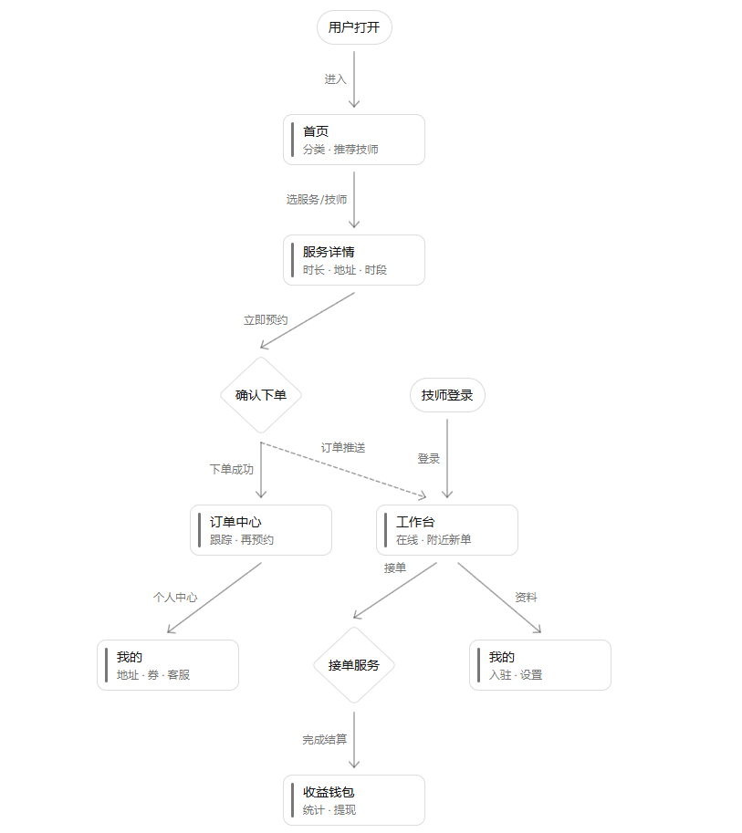
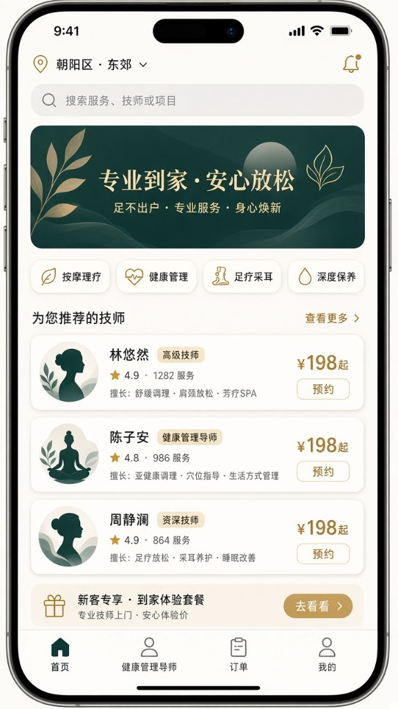
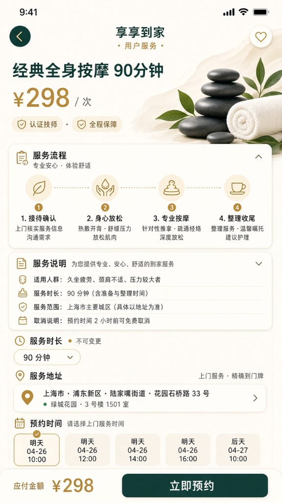
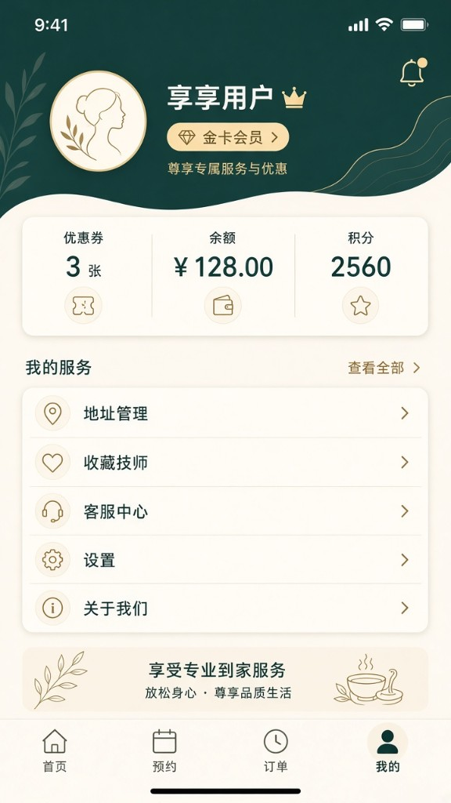
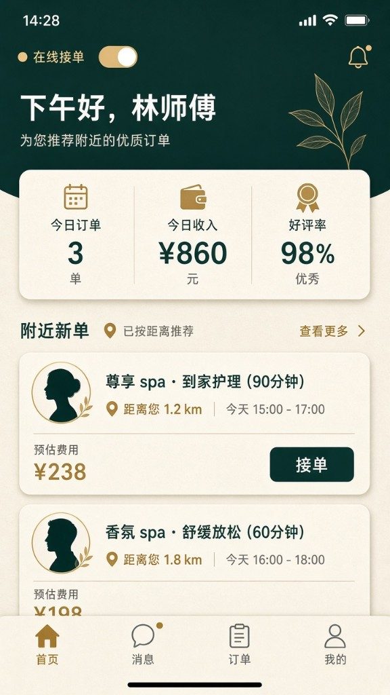
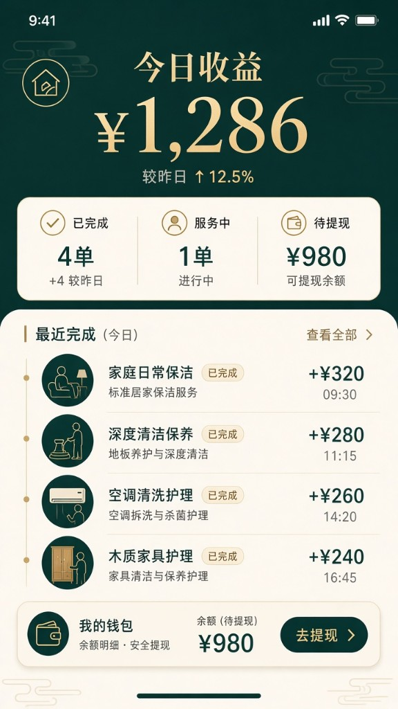
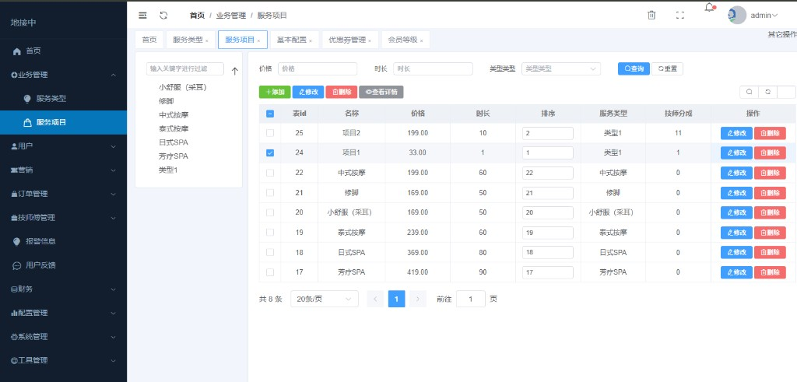

# 预约到家

这是一套三方撮合平台：客户下单、服务者接单、后台审核分成和结算，把上门需求和可接单的人匹配起来。上门按摩、推拿、采耳、芳疗的预约到家系统，和东郊到家是同一类到家服务生意。

同一套上门服务平台结构，也能拿去改代驾、安师傅代驾、婚车租赁、上门维修、家政保洁、跑腿这些本地生活、同城到家生意。核心都是供需匹配、接单派单和平台分成。

一套 Go 接口同时给三个前端用：Vue 3 管理后台，以及 uni-app 写的用户端、技师端。数据在 MySQL。

Three-sided marketplace and matching platform: customer, provider, and admin. Same shape as an on-demand local-services dispatch app — home massage, 东郊到家, designated driving (安师傅代驾), wedding-car rental, door-to-door repair, and housekeeping.

## 适用场景

适合要做 O2O 上门服务、接单平台或本地生活撮合的团队：一边是下单的客户，一边是接单的服务者，中间是审核、派单和结算的后台。业务可以是到家按摩，也可以是代驾、维修、保洁一类的即时上门。

## 流程

用户从首页选服务、确认下单，订单推到技师工作台。技师接单服务，完成后进入收益钱包。用户自己的地址、优惠券和客服在「我的」。

## 界面

用户端和技师端：

  
  
  
  
  

管理后台，服务项目、价格、时长和技师分成都在这里改：

## 这套代码从哪来

杭州有位老板来下单，开着跑车。他说到了上海就签合同，让我先回去开发。我回去之后把用户端、技师端、管理后台和接口做成了现在这样。合同没有签，老板也没有下文。

代码留在这里。想看、想学、想在自己电脑上跑，可以直接下载。拿去商用，先找我授权。

## 授权

可以下载、阅读、修改，也可以本地运行，用于学习和非商业演示。

上线经营、交付给客户、收费、转卖，或放进其他收费产品，都要先得到书面授权。完整约定见 [LICENSE](LICENSE)。

## 联系

微信号 `qiangui8`。微信扫这张码即可加好友，也可以直接搜这个号。

## 文档

| 你要做的事 | 看这里 |
| --- | --- |
| 把项目在本机跑起来 | [启动文档](dev/docs/启动文档.md) |
| 改接口、页面、订单和分成 | [开发文档](dev/docs/开发文档.md) |

## 能做什么

- **用户端**：看项目和技师，填上门地址，下单，看订单，使用优惠券，管钱包。
- **技师端**：看新订单和进行中的订单，设置服务时间和上门范围，上传身份认证，紧急报警。
- **管理后台**：审核技师，维护服务项目和技师分成，处理订单、优惠券、提现和报警。

## 技术栈

| 部分 | 技术 |
| --- | --- |
| 接口 | Go 1.23，标准库 HTTP，MySQL |
| 管理后台 | Vue 3，Vite，Element Plus |
| 用户端、技师端 | uni-app（Vue 2），用 HBuilderX 跑 H5 |
| 数据 | MySQL 5.7，库名 `smam_sql`，表前缀 `cd_` |

## 目录

| 目录 | 是什么 |
| --- | --- |
| `dev/server` | Go 接口，默认端口 8088 |
| `dev/admin` | 管理后台，默认端口 5173 |
| `dev/user` | 用户端 |
| `dev/tech` | 技师端 |
| `dev/uploads` | 上传的图片和录音，由接口的 `/uploads/` 提供访问 |
| `dev/smam_sql.sql` | 当前库的导出。`cd_log` 只留表结构 |
| `dev/docs` | 启动文档、开发文档、界面图、微信二维码 |

仓库根目录的 `一键启动新后端.bat` 会拉起 MySQL（如果没开）、Go 接口、管理后台，并用 HBuilderX 打开两个 H5。停掉接口和后台用 `停止新后端.bat`。

本地地址、账号和导入数据库的命令在[启动文档](dev/docs/启动文档.md)。接口写好后看 http://127.0.0.1:8088/health 。

三个前端请求的路径都是 `/public/index.php/{端}/{控制器}/{方法}`。这是现在这套 Go 接口的地址。
