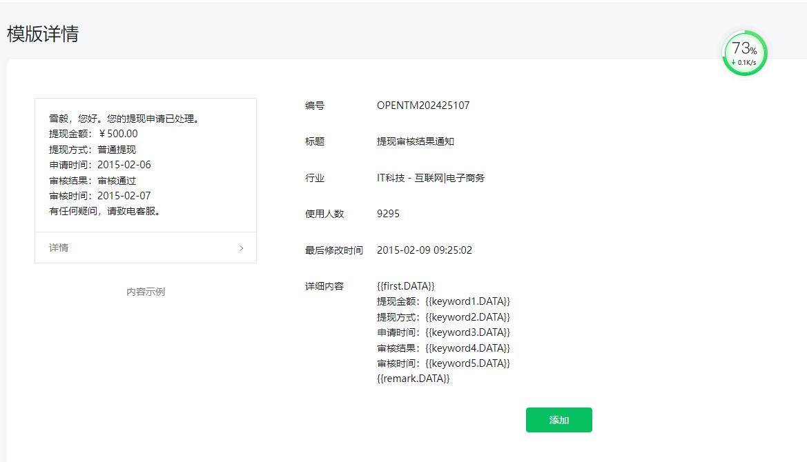
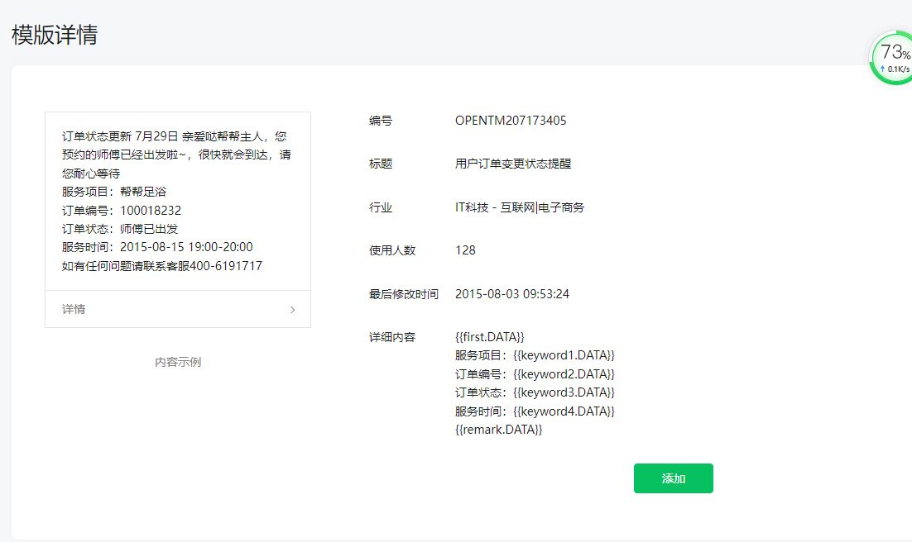
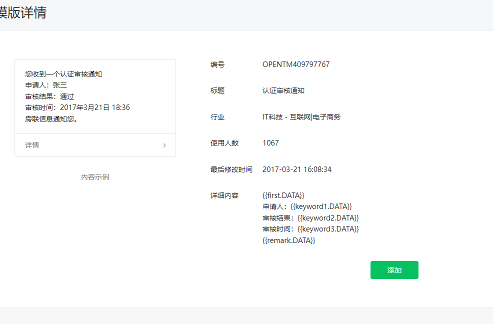
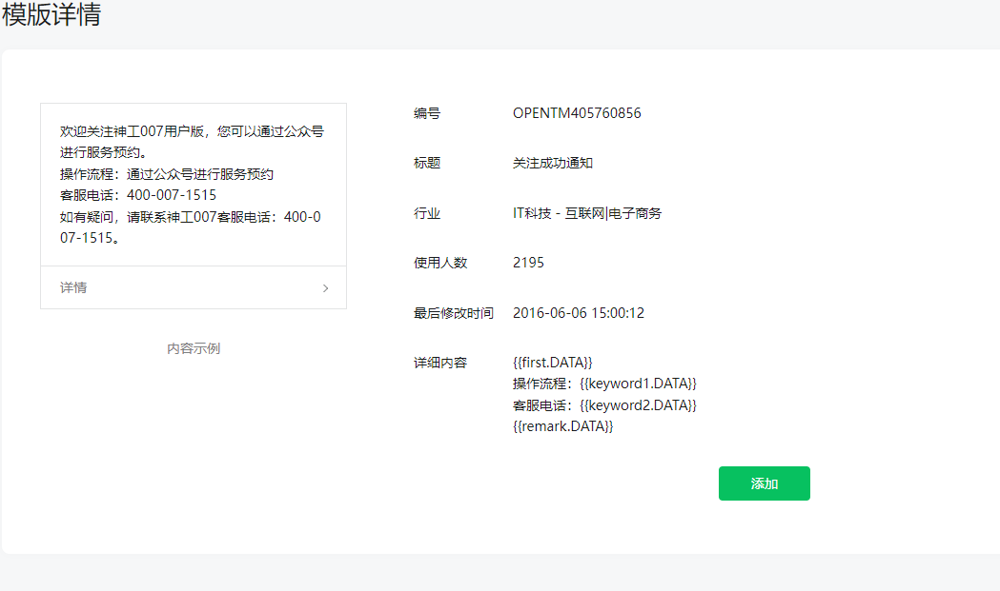

使用说明

php 版本只支持 7.4

vue 目录在 ui/目录 内置全部所需依赖包 无需安装其它的

运行 进入 ui 目录
启动命令行 npm run serve
打包命令行 npm run build (打包成功的生成的文件在 ui/disk)

环境搭建
安装 vscode 编辑器
安装 node.js  
在安装 vue 命令行 npm install vue -g 不会请百度

在配置 php 环境 php 环境同原来的一样
接口的域名配置路径 ui/src/api/request.js http://xhadmin.me 改成自己的本地域名即可 后面的 admin 无需改变
数据库文件 根目录的 data.sql

注意事项：
1、上传图片需要配置前缀域名 不然在测试环境上传成功无法预览 （后台 ->系统配置->基本配置 ->上传配置-> 绑定域名）

2、不要升级内核 tp 内核已经升级到 6.08 否则图片验证码显示不出来 这一块做了二开

3、ui 目录不要改变名称 以及路径不然生成的 vue 文识别不了目录 上线后可以删除

4、后台登录账号密码 admin admin

5、数据库配置 config/database.php

功能特别说明：
1、支持配置单设备登录 或者多设备登录 在 config/my.php multiple_login 选项
2、支持验证码的开关 在 config/my.php
3、其他配置 参考注释说明

后台环境：

1、php =>7.4

2、mysql =>5.6

3、网站配置伪静态

安装配置：

1、创建数据库并导入根目录 www_yldsmfw.sql

2、修改 config/database.php 数据库配置项

3、修改 cd_base_config 表 中微信配置，oss 配置，短信配置，客服配置；其余按需配置

4、替换 public/uploads/wx 中的微信证书

5、修改 config/my.config 中 oss 配置

6、去除或修改 app/techniaian/controller/index callPolice 方法中 msgSend 调用

7、去除或修改 app/api/controller/pay order 方法中 msgSend 调用

8、替换 extend/wxpay/Wxpay.php 及 alypay/AlyPay 中 一里达 换成自己 app 名称

9.创建宝塔 shell 定时任务每分钟 'php /www/wwwroot/www_yld_com/think crontab',/www/wwwroot/www_yld_com/是站点跟目录

10、修改根目录 app/common.php 中 sendWithdrawalMsg，sendAuthenticationMsg，sendOrderMsg，
sendFollowMsg 方法中的 template_id 及 appid （公众号）需关联小程序

